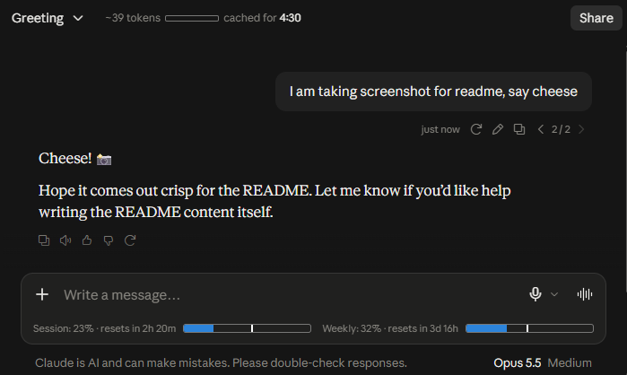

<p align="center">
  
</p>

<h1 align="center">Claude Counter (swap407)</h1>

<p align="center">
  Token count, cache timer and usage bars for claude.ai.<br>
  Browser extension (Chrome, Edge, Firefox) and userscript.
</p>

<p align="center">
  
  
  
</p>

Fork of [she-llac/claude-counter](https://github.com/she-llac/claude-counter), updated for the redesigned claude.ai and extended with settings, notifications and per-model limits.



## Features

- **Token count**: approximate token count for the current conversation, with a mini bar against the context window. Hover for a breakdown (your messages, Claude's replies, tool calls and results, attached files) and the model.
- **Cache timer**: countdown showing how long the conversation stays cached (cheaper to continue). It turns amber in the last minute.
- **Usage bars**: session (5-hour) and weekly (7-day) usage from Claude's own API, with reset countdowns. Per-model weekly limits (e.g. Fable) get their own bar. Hover a bar for the exact reset date and time.
- **Survives reloads**: the last known usage is shown (dimmed) right away after a reload, until claude.ai confirms fresh numbers.
- **Works with the new claude.ai reply transport**: on accounts where replies arrive over Connect RPC instead of `/completion` streaming, the bars and token count refresh after each reply.
- **Notifications (optional)**: when usage reaches 75% and 90%, when a window resets, before a reset if under half is used, and when the prompt cache is about to expire while the tab is in the background.
- **Settings**: right-click the counter (or click the extension's toolbar icon) to show or hide parts, switch to compact labels, show reset times as a clock instead of a countdown, set the context bar scale (200k, 500k, 1M), and turn notifications on.

## Installation

**Chrome / Edge / Chromium**

1. Download this repository ([zip](https://github.com/swap407/claude-counter/archive/refs/heads/main.zip)) and unzip it, or `git clone` it
2. Go to `chrome://extensions` and turn on **Developer mode**
3. Click **Load unpacked** and select the folder that contains `manifest.json`

**Firefox**

1. Download or clone this repository
2. Open `about:debugging#/runtime/this-firefox`, click **Load Temporary Add-on…**, and select `manifest.json`

**Userscript** (Tampermonkey, Violentmonkey)

1. Open [`claude-counter.user.js`](https://raw.githubusercontent.com/swap407/claude-counter/main/userscript/claude-counter.user.js) and install it. Updates come from this repository's `main` branch.

## How it works

- Intercepts Claude's API responses to read conversation data and usage info
- Uses a vendored tokenizer (`o200k_base`) for approximate token counting. Claude's own tokenizer isn't public, so counts are estimates, and they exclude the system prompt and context Claude adds itself (e.g. web search results)
- Uses Claude's `/usage` endpoint plus live `message_limit` events from reply streams, which carry exact, unrounded utilization
- Watches for DOM changes to place the UI as you navigate

## Troubleshooting

If the counter disappears after a claude.ai update, open DevTools (F12) on claude.ai, go to the **Console** tab and run:

```js
dispatchEvent(new Event('cc:debug'))
```

It prints which page elements the counter can and can't find, and the current state. Include that output when reporting a problem. All page selectors are in [`src/content/constants.js`](./src/content/constants.js).

## Development

The extension sources live in `src/`. The userscript is generated from them, so write changes once in `src/` and rebuild:

```sh
npm run build   # regenerate userscript/claude-counter.user.js
npm run check   # fail if the userscript is out of date
```

No dependencies are needed beyond Node.js 18+.

## Privacy

- All data stays local: no external servers, no tracking
- Reads your `lastActiveOrg` cookie to query Claude's `/usage` endpoint
- Makes requests only to `claude.ai`
- Settings and the last usage snapshot are kept in claude.ai's `localStorage`
- Notifications are shown by your browser and are only enabled if you turn them on

## Credits

- Token counting via [gpt-tokenizer](https://github.com/niieani/gpt-tokenizer) (MIT)
- Inspired by [Claude Usage Tracker](https://github.com/lugia19/Claude-Usage-Extension) by lugia19
- Per-model limits, exact reset times and notifications build on ideas from pull requests #53, #14 and #23 to the original repository

## License

MIT
